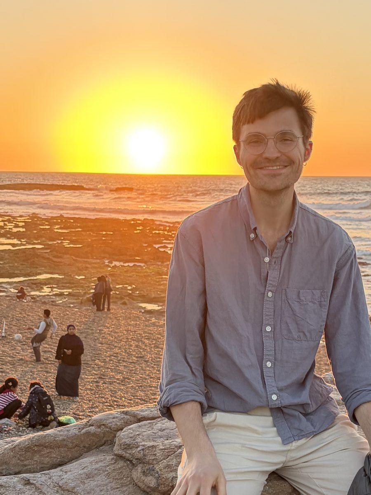

```{=html}
<div class="intro">
  <div class="intro-text">
    <h1>Zach Hopton</h1>
    <p class="lede">I’m a <span class="hl">PhD student at the University of Zurich</span>, supervised by <a href="https://eleanorchodroff.com/">Eleanor Chodroff</a>.</p>
    <p>As part of the SNF project &ldquo;Strengthening the Role of Generative Machine Learning in Psycholinguistics,&rdquo; I also work closely with <a href="https://rycolab.io/authors/ryan/">Ryan Cotterell</a> and his lab at ETH Zurich. My entry point to linguistics was amazement at how diverse the world’s languages are, and now my research reflects that with three major questions:</p>
  </div>
  
</div>
```

1. What are the underlying [cognitive mechanisms]{.hl} that allow humans to use such a diverse range of languages efficiently?
2. What can speech processing models tell us about how [sound patterns]{.hl} are realized across speakers and languages? 
3. How can [language technology]{.hl} be made to perform better for diverse language varieties?

To that end, my research usually falls somewhere in:

* (Computational) Phonetics
* (Computational) Psycholinguistics
* Multilingual Speech and Language Technology

I also love to keep up with work on typology and hope to veer into the field more myself at some point. 

More on the [research page](research.qmd), or see my [publications](publications.qmd) and [CV](cv.qmd) (being updated).

In my free time, I enjoy all things cardio (running, cross-country skiing, and recently cycling), baking, and learning languages (predictable, I know). I particularly like mixing my running with travel, feel free to follow along on [Strava](https://strava.app.link/Tx4Z1aJ1a7b)!